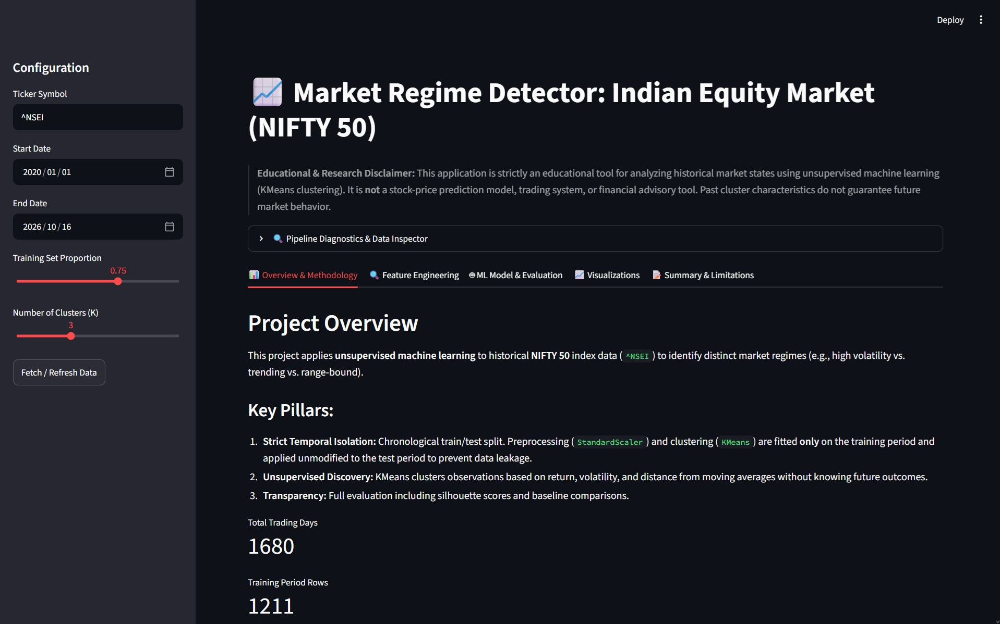

# Market Regime Detector: Indian Equity Market (NIFTY 50)

An interactive machine learning application that uses unsupervised learning to explore historical market regimes in India's NIFTY 50 index.

The project combines time-series feature engineering, KMeans clustering, chronological evaluation, and interactive visualizations to investigate how market behavior changes over time.



## Overview

Financial markets exhibit different behavioral patterns, including relatively calm periods, sustained upward or downward movements, and episodes of elevated volatility.

This project explores whether historical market observations can be grouped into distinct regimes using unsupervised machine learning. It analyzes price-derived features, learns clusters from a training period, and examines how those clusters behave on unseen historical data.

The application is designed for educational and analytical purposes. It does not predict future prices, generate trading signals, or recommend investments.

## Features

- **Historical data:** Retrieve NIFTY 50 index data using Yahoo Finance.
- **Time-series feature engineering:** Calculate returns, rolling volatility, momentum, and moving-average distance.
- **Unsupervised learning:** Apply KMeans clustering to identify groups of similar market observations.
- **Leakage-aware evaluation:** Use chronological train/test splitting and fit preprocessing on training data only.
- **Cluster analysis:** Examine cluster characteristics, observation counts, and regime distributions.
- **Interactive dashboard:** Explore market behavior and model results through Streamlit.
- **Automated testing:** Validate data handling, feature calculations, clustering, and evaluation using pytest.

## Technology Stack

| Technology | Purpose |
|---|---|
| Python | Core implementation |
| pandas and NumPy | Data processing and numerical calculations |
| yfinance | Historical market data |
| scikit-learn | Feature scaling, KMeans, and evaluation |
| matplotlib | Data visualization |
| Streamlit | Interactive dashboard |
| pytest | Automated testing |

## Getting Started

### Prerequisites

- Python 3.10 or newer
- Git
- Internet access for retrieving historical market data

### Installation

Clone the repository and navigate to the project directory:

```powershell
git clone https://github.com/p1xl07/market-regime-detector.git
cd market-regime-detector
```

Create and activate a virtual environment:

```powershell
python -m venv .venv
.\.venv\Scripts\Activate.ps1
```

Install the dependencies:

```powershell
python -m pip install -r requirements.txt
```

### Run the application

```powershell
python -m streamlit run app.py
```

Open the local URL displayed in the terminal, typically `http://localhost:8501`.

The application retrieves historical data through Yahoo Finance. Availability depends on the external data provider and network connectivity.

### Run the tests

```powershell
python -m pytest tests/ -v
```

The automated tests are designed to validate core functionality without requiring live market data.

## Machine Learning Methodology

### 1. Data collection

The application retrieves historical NIFTY 50 index data using the Yahoo Finance ticker `^NSEI`.

The data is validated before processing to identify issues such as missing observations, duplicate dates, invalid prices, and insufficient history.

### 2. Feature engineering

The model uses five price-derived features.

| Feature | Definition | Lookback |
|---|---|---|
| Daily return | Percentage change from the previous closing price | 1 trading day |
| Cumulative return | Percentage change relative to the closing price 20 trading days earlier | 20 trading days |
| Annualized volatility | Rolling standard deviation of daily returns multiplied by \(\sqrt{252}\) | 20 trading days |
| Moving-average distance | Relative difference between the closing price and its 50-day moving average | 50 trading days |
| Momentum | Percentage change relative to the closing price 5 trading days earlier | 5 trading days |

Initial observations without sufficient historical data for rolling calculations are excluded from model fitting.

All features are derived from historical prices available at the corresponding observation date. No future returns are used as model inputs.

### 3. Preprocessing and clustering

The feature matrix is standardized using scikit-learn's `StandardScaler`. A KMeans model with three clusters is fitted on the training period.

The model groups observations according to similarity in standardized feature space. Cluster IDs are arbitrary and do not inherently represent bull, bear, or sideways markets.

The resulting clusters are interpreted using their observed returns, volatility, momentum-related behavior, and moving-average distance.

### 4. Chronological evaluation

The dataset is split chronologically into training and test periods.

- The scaler is fitted exclusively on training features.
- KMeans learns its centroids from training observations.
- Test observations are transformed using the fitted training scaler.
- Test assignments are produced using the existing centroids without refitting on test data.

This approach helps prevent information leakage and evaluates whether the learned clusters remain useful for organizing observations from a later period.

### 5. Evaluation metrics

The application reports silhouette scores to assess cluster cohesion and separation in standardized feature space.

A random-label baseline is also provided as a limited reference for comparison.

Silhouette scores do not measure predictive accuracy, investment profitability, or the ability to forecast future market movements. A visually distinct cluster is not necessarily an economically meaningful market regime.

## Understanding the Results

The dashboard presents historical price behavior, cluster assignments, cluster profiles, and evaluation metrics.

Some clusters may contain very few observations or no observations in the test period. This can happen when a pattern found in the training period does not recur in the held-out period.

Such cases should be interpreted using the observed data rather than forced into predefined market categories. Cluster assignments may also change when the selected date range, features, or model configuration changes.

## Project Structure

```text
market-regime-detector/
├── README.md
├── requirements.txt
├── .gitignore
├── app.py
├── src/
│   ├── __init__.py
│   ├── data.py
│   ├── features.py
│   ├── model.py
│   ├── evaluation.py
│   └── visualization.py
├── tests/
│   ├── test_data.py
│   ├── test_features.py
│   ├── test_model.py
│   └── test_evaluation.py
└── assets/
    └── Screenshot.jpg
```

## Limitations

- Historical patterns do not guarantee that similar conditions will recur.
- KMeans assumes clusters can be represented using distances to centroids and is sensitive to feature selection and scaling.
- The choice of three clusters is a configurable modeling assumption, not proof that markets contain exactly three regimes.
- Rare market events may form small clusters that are difficult to evaluate using a limited test period.
- Silhouette scores evaluate geometric cluster separation, not financial usefulness.
- Historical data retrieval depends on an external provider and may be incomplete or unavailable.
- Results can change with the selected date range, downloaded data, and model configuration.

## Future Improvements

Potential extensions include comparing different clustering algorithms, evaluating alternative feature sets, studying regime stability across multiple chronological windows, and improving the interpretability of detected clusters.

## Disclaimer

This project is intended for educational and research purposes only. It is not financial advice, an investment recommendation system, or a guarantee of future market behavior.
